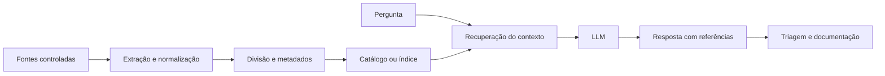

# MVP de automação com LLM

Este projeto nasceu de um problema que conheço na operação: a informação existe, mas costuma ficar espalhada entre documentos, páginas, anotações e históricos. Antes de resolver um incidente ou responder uma dúvida, parte do tempo é gasta procurando o material certo e organizando o contexto.

A ideia do MVP foi criar um caminho simples para consultar fontes controladas, organizar o conteúdo e gerar uma resposta útil para a operação. O objetivo não era construir uma plataforma completa logo no início. Eu queria validar a arquitetura, entender os limites e manter o consumo previsível.

## O que o MVP buscava resolver

- localizar informações em fontes diferentes sem fazer a mesma busca várias vezes;
- reunir o contexto antes da análise do modelo;
- padronizar respostas sem esconder de onde a informação veio;
- apoiar documentação e triagem técnica;
- reduzir trabalho manual em tarefas repetitivas;
- controlar custo, volume processado e dependência de serviços externos.

## Como organizei a solução

Separei o fluxo em três partes:

1. **Origem dos dados:** documentos e conteúdos textuais escolhidos para a consulta.
2. **Processamento:** extração, normalização, divisão do conteúdo, recuperação do contexto e chamada ao modelo.
3. **Saída operacional:** resposta organizada, referências utilizadas e material que pode voltar para a documentação.

Essa separação permite trocar uma fonte ou um modelo sem refazer todo o projeto. Também facilita identificar onde uma resposta falhou: na origem, na preparação do conteúdo, na busca ou na geração.

## O que decidimos não fazer nesta etapa

### Processamento de vídeos

Vídeos ficaram fora do MVP. Para usá-los de forma responsável, seria necessário extrair ou transcrever o áudio, tratar duração, idioma, ruído, identificação de quem fala e divisão por tempo. Dependendo do conteúdo, ainda seria necessário analisar quadros e apresentações exibidas na tela.

Isso aumentaria o custo, o tempo de processamento, o armazenamento e a quantidade de pontos de falha antes de validarmos o fluxo principal. A escolha foi trabalhar primeiro com texto. Quando uma fonte nasce em vídeo, a entrada preferida nesta fase é uma transcrição revisada e acompanhada do link e dos marcadores de tempo.

### Integração direta com o NotebookLM

O NotebookLM era uma referência importante pela forma como trabalha com fontes e respostas apoiadas no conteúdo enviado. Mesmo assim, não colocamos uma integração direta no núcleo do MVP.

Na versão pessoal, não tínhamos um caminho oficial e estável para automatizar todo o fluxo que precisávamos. O Google passou a documentar APIs para o **Gemini Notebook Enterprise**, mas elas estão em preview e exigem projeto no Google Cloud, configuração, permissões e licenciamento próprios. Para um MVP voltado a baixo custo e controle, essa dependência mudaria o tamanho do projeto.

Por isso, o NotebookLM ficou como ferramenta complementar para comparação manual e estudo. A arquitetura continua independente: se uma integração adequada fizer sentido no futuro, ela entra como um adaptador, sem substituir o restante do fluxo.

## Princípios adotados

- começar pequeno e medir antes de aumentar o escopo;
- manter fonte, processamento e saída separados;
- responder somente com o contexto recuperado;
- mostrar as referências usadas;
- admitir quando o material não é suficiente;
- evitar enviar dados sensíveis sem necessidade;
- limitar tamanho, quantidade de chamadas e custo por execução;
- registrar erros e decisões para aprender com os testes.

## O que conseguimos validar

O MVP saiu do desenho e foi aplicado no Google Cloud. A base de dados organizada no Google Drive ficou funcional e pôde ser usada como fonte do fluxo de consulta e análise. Com isso, conseguimos validar na prática a separação entre origem dos dados, processamento pelo modelo e saída operacional.

O trabalho também definiu o recorte do MVP, a arquitetura e os limites técnicos. Ele serviu para ligar minha experiência em infraestrutura e operação ao caminho que estou construindo em engenharia de IA.

Este repositório documenta o raciocínio e as decisões. Ele não publica dados internos, credenciais, bases privadas ou conteúdo usado apenas durante experimentos.

## Documentação

- [Arquitetura](docs/arquitetura.md)
- [Decisões do projeto](docs/decisoes.md)
- [Escopo e limitações](docs/escopo-e-limitacoes.md)
- [Próximos passos](docs/proximos-passos.md)
- [Segurança e privacidade](SECURITY.md)

## Tecnologias e serviços usados

O MVP foi aplicado no Google Cloud e utilizou uma base organizada no Google Drive. O desenho manteve uma camada para ingestão e orquestração, preparação dos documentos e metadados, recuperação do contexto e acesso ao modelo.

O valor do MVP ficou na validação do fluxo completo e dos critérios de resposta. As tecnologias foram usadas para resolver cada parte do problema, sem transformar a arquitetura numa lista de ferramentas.

## Resultado esperado

Uma pergunta deve gerar uma resposta curta, verificável e útil para a operação. Quando a fonte não trouxer a resposta, o sistema deve dizer isso claramente. Uma resposta convincente sem apoio no material é uma falha, mesmo quando parece correta.

